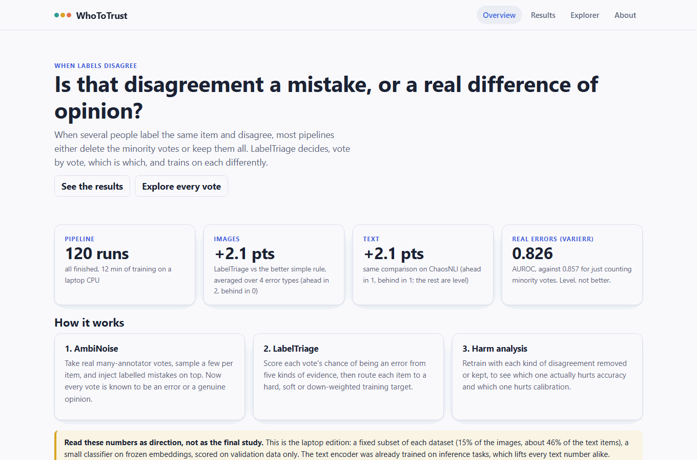
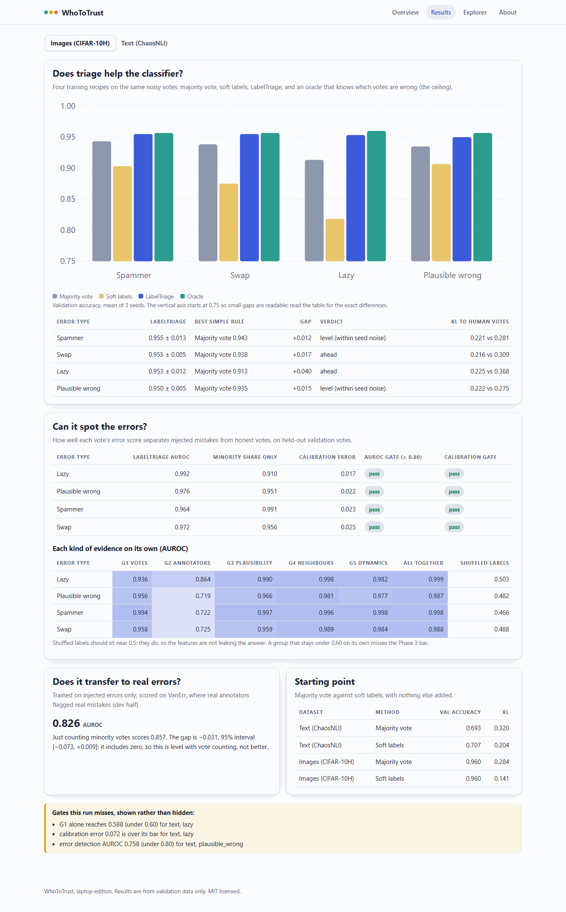
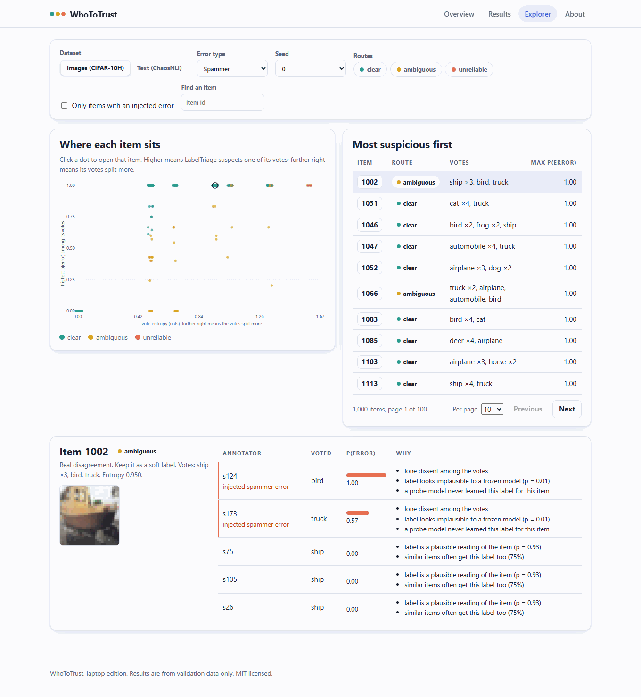

# WhoToTrust

[](https://github.com/MuzraFatima/WhoToTrust/actions/workflows/ci.yml)
[](LICENSE)

**When labels disagree, who should you trust? Is it a mistake, or a real difference of opinion?**

When several people label the same item and disagree, most pipelines either delete the minority
votes (noisy-label learning) or keep every vote as a soft label (human label variation).
WhoToTrust is built around **LabelTriage**, a method that decides, **vote by vote**, whether a disagreement is an error or genuine ambiguity,
then trains on each differently. This repository holds the method, a benchmark for testing it,
the experiments, and a web app for exploring every scored vote. It runs end to end on an
ordinary laptop CPU.



## What is in the box

| Part | What it is |
|---|---|
| **AmbiNoise** | A benchmark built from real many-annotator votes (CIFAR-10H images, ChaosNLI text) with labelled errors injected on top: spammers, swapped classes, lazy annotators, and plausible-looking wrong answers. |
| **LabelTriage** | Scores each vote's chance of being an error from five kinds of evidence, then routes each item to a hard, soft or down-weighted training target. |
| **Harm analysis** | Retrains with each kind of disagreement removed or kept, to see which one hurts accuracy and which hurts calibration. |
| **Web app** | A React app over a small Python API: an overview, the results, and an explorer for every item and vote. |

## Quick start

You need Python 3.11+ and, for the web app, Node 20+.

```bash
# 1. Install
python -m venv .venv && source .venv/bin/activate      # Windows: .venv\Scripts\activate
pip install -e ".[train,features,crowd,app,dev]"

# 2. Get the data (CIFAR-10H, VariErr and CIFAR-10 download by themselves; ChaosNLI is manual)
python -m labeltriage.data.prepare cifar10h varierr chaosnli --data-dir data

# 3. Run the whole pipeline on the laptop-sized subsets (about 45 minutes the first time)
python scripts/make_mini.py --seed-cache
python scripts/run_mini.py

# 4. Build and open the web app
cd web && npm ci && npm run build && cd ..
python -m labeltriage.api --open                         # http://127.0.0.1:8000
```

ChaosNLI's download link blocks scripts. Get it from the
[ChaosNLI repository](https://github.com/easonnie/ChaosNLI) in a browser and put
`chaosNLI_snli.jsonl` and `chaosNLI_mnli_m.jsonl` in `data/raw/chaosnli/`.

`run_mini.py` is resumable: if it stops, run it again and it picks up where it left off. Every
later run is quick, because the models and features are cached.

## The web app

| | |
|---|---|
|  |  |
| **Results.** How each training recipe does under each kind of error, how well errors are spotted, the transfer to real errors, and every gate the results miss. | **Explorer.** Every item as a dot. Click one to see its picture or text, each vote, the model's error score, and the plain-language reasons behind it. |

Filter by dataset, error type, seed and route, search by item, and page through the list.
It follows your system's light or dark setting
([dark overview](docs/screenshots/overview-dark.png), [text explorer](docs/screenshots/explorer-text.png)).

## Results

These come from the laptop edition (below), on validation data, as the mean of 3 seeds. The
oracle knows which votes are wrong, so it is the ceiling.

| Data | Error type | Majority vote | Soft labels | **LabelTriage** | Oracle |
|---|---|---|---|---|---|
| Images | spammer | 0.943 | 0.903 | **0.955** | 0.957 |
| Images | swap | 0.938 | 0.875 | **0.955** | 0.957 |
| Images | lazy | 0.913 | 0.818 | **0.953** | 0.960 |
| Images | plausible wrong | 0.935 | 0.907 | **0.950** | 0.957 |
| Text | spammer | 0.682 | 0.682 | **0.689** | 0.684 |
| Text | swap | 0.640 | 0.651 | **0.640** | 0.664 |
| Text | lazy | 0.538 | 0.536 | **0.629** | 0.664 |
| Text | plausible wrong | 0.669 | 0.680 | **0.678** | 0.684 |

- **Images:** LabelTriage beats both simple rules for every error type and lands within 1 point
  of the oracle.
- **Text:** a clear gain for lazy errors (+9 points), level elsewhere. Seed spread is 1 to 2
  points, so those gaps are within noise.
- **Spotting errors:** validation AUROC is 0.96 to 0.99 on images and 0.76 to 0.95 on text.
- **Real errors (VariErr):** trained on injected errors only, it scores AUROC 0.826 against
  0.857 for simply counting minority votes. That is level, not better.
- **Misses are shown, not hidden:** on text, vote statistics alone reach only 0.588 for lazy
  errors (bar: 0.60), and the calibration gate is missed for lazy and plausible-wrong errors.

Full tables and the numbers behind every claim: [`docs/results-mini.md`](docs/results-mini.md).

## What this edition is, and is not

- **It is** a complete, tested, reproducible project that runs on a laptop with only the data in
  this folder. Every number above comes from real runs you can repeat, and the same two
  commands reproduce them exactly.
- **It uses** a fixed, stratified subset of each dataset (1,500 of the 10,000 CIFAR-10H images,
  1,200 of 2,613 ChaosNLI items, all 500 VariErr items) and a small classifier on frozen
  embeddings, instead of fine-tuning ResNet-18 and DeBERTa. Details: amendment A15 in
  [`docs/blueprint-amendments.md`](docs/blueprint-amendments.md).
- **It is not** the blueprint's full-scale, pre-registered study. That needs a GPU and was not
  run, so these results are indicative, not confirmatory. Scores are on validation data only;
  the sealed test splits were never read, and the analysis script refuses laptop-edition runs.
  The instructions for the full study are kept in
  [`docs/full-scale-study.md`](docs/full-scale-study.md).
- **The text encoder** for the laptop edition was already trained on inference tasks, which
  lifts every text number alike.

## How it works

1. **AmbiNoise.** Sample K real votes per item, credit them to simulated annotators, and
   corrupt exactly the chosen share of votes. Every vote is now known to be an error or a
   genuine opinion. ([`docs/ambinoise-card.md`](docs/ambinoise-card.md))
2. **LabelTriage.** Five groups of evidence per vote: how the votes split (G1), how reliable the
   annotator is (G2), whether a frozen model finds the label plausible (G3), what similar
   items received (G4), and whether a probe model ever learned it (G5). A calibrated model turns
   them into p(error), out of fold. Items then go to three routes: **clear** (hard label),
   **ambiguous** (soft label) or **unreliable** (down-weighted).
3. **Harm analysis.** Counterfactual retraining that removes errors, collapses ambiguity, both,
   or neither.

## Repository layout

```
src/labeltriage/
  api.py           JSON API and server for the web app
  conf/            Hydra configs: data, method, experiment, sweep, profile (full / mini)
  data/            dataset loaders and the shared annotation store
  ambinoise/       the benchmark: sampler, annotators, error processes
  features/        the five evidence groups (G1 to G5)
  triage/          the error model, calibration and the router
  train/           trainers, including the frozen-embedding head
  eval/            metrics, hypotheses, summaries, the analysis guard
web/               React app (Vite), unit tests and end-to-end tests
scripts/           run_mini.py, make_mini.py, analysis, release and Kaggle helpers
tests/             pytest suite (CPU, no downloads)
docs/              blueprint, amendments, results, performance, paper and defence drafts
```

## Testing

```bash
pytest                                  # 219 Python tests
cd web && npm test                      # unit tests (Vitest)
cd web && npm run e2e                   # end to end in real Google Chrome
cd web && npm run lint                  # ESLint; Python uses ruff
```

CI runs ruff, the Python tests on 3.11 and 3.12, and the web lint, unit tests and build.
`npm run e2e` drives your installed Chrome against the real server and results; it checks every
page, filter, click, the item pictures, compression and caching, and path-traversal refusal,
and fails on any console or network error. Performance work and the Lighthouse audit are in
[`docs/performance.md`](docs/performance.md).

## Credits

This project builds on open data and tools. Thank you to their authors:

- **CIFAR-10H**: Peterson, Battleday, Griffiths and Russakovsky, *Human Uncertainty Makes
  Classification More Robust*, ICCV 2019.
- **CIFAR-10N**: Wei, Zhu, Cheng, Liu, Niu and Liu, *Learning with Noisy Labels Revisited*,
  ICLR 2022.
- **ChaosNLI**: Nie, Zhou and Bansal, *What Can We Learn from Collective Human Opinions on
  Natural Language Inference Data?*, EMNLP 2020.
- **VariErr NLI**: Weber-Genzel, Peng, de Marneffe and Plank, ACL 2024. It is the closest prior
  work, and it is used here only as a transfer test.
- **CIFAR-10**, **CIFAR-10.1** (Recht et al.) and **CIFAR-10-C** (Hendrycks and Dietterich).
- **cleanlab** (Confident Learning, CROWDLAB) and the Dawid–Skene model (Dawid and Skene, 1979),
  reimplemented here in NumPy.
- **Hugging Face Transformers**, **PyTorch**, **LightGBM**, **scikit-learn**, **Hydra**,
  **FastAPI**, **React** and **Vite**.

## License

Code is released under the [MIT License](LICENSE). Each dataset keeps its own licence.
